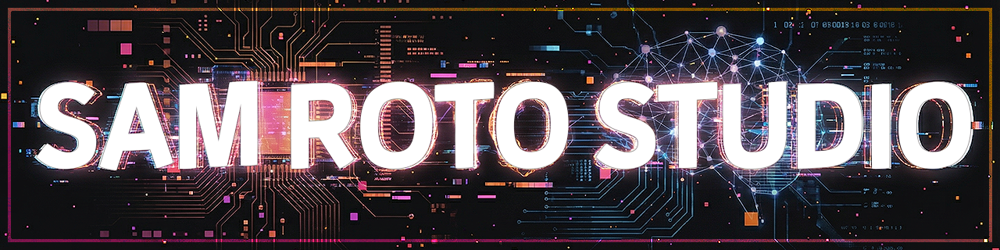
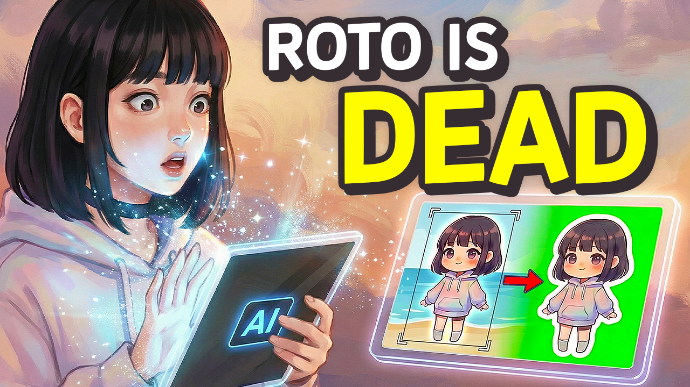

# SAM Roto Studio

**AI-assisted rotoscoping in Google Colab. High-quality alpha mattes with no effort, saving you time.**

&nbsp;

---

## Demo

All outputs are **untouched** — straight from the pipeline.

> **Difficulty:** 🟦⬜⬜⬜⬜ **Very Easy**  
> **Input Conditions:** motion blur

https://github.com/user-attachments/assets/c39db68a-4684-4045-be5a-636ca106a520

 

> **Difficulty:** 🟩🟩⬜⬜⬜ **Easy**  
> **Input Conditions:** low contrast, color blending

https://github.com/user-attachments/assets/0588e20e-cc41-4b0e-9632-a0a898627161

 

> **Difficulty:** 🟨🟨🟨⬜⬜ **Medium**  
> **Input Conditions:** kinetic motion, frame-edge clipping, temporary object occlusion

https://github.com/user-attachments/assets/a540cbdd-04a8-45f4-b10a-a6a6a633a401

 

> **Difficulty:** 🟧🟧🟧🟧⬜ **Hard**  
> **Input Conditions:** very low contrast, color blending, fine hair

https://github.com/user-attachments/assets/1ba4366d-f90e-44d4-a3d7-7127aa782247

 

> **Difficulty:** 🟥🟥🟥🟥🟥 **Very Hard**  
> **Input Conditions:** low contrast, multiple objects, objects overlapping

https://github.com/user-attachments/assets/849dca05-af3a-45fc-84c4-0d0c6dd65462

---

## Quick Start

1. **Click the Colab badge** above to open the project
2. **Run both cells** to install then launch
3. **Upload your footage** and pick a tool  
4. **Download your alpha sequence** or composited result

That's it. No local setup. No terminal commands.

---

## Tools

| Tool | Best For | How It Works |
|------|----------|--------------|
| **InSPyReNet** | Salient subjects, good contrast | Fully automatic — no prompts needed |
| **MatAnyone** | More control, faster results | Single SAM prompt → auto-propagation |
| **SAM + ViTMatte** | Complex motion, low contrast | SAM tracking → edge refinement |

> 💡 **Tip:** Results vary by footage, A/B test to find the cleanest matte.  
> **SAM + ViTMatte** is typically the most consistent.

---

## Tutorial

Full walkthrough from zero to compositing.

*Click to watch on YouTube (3 min)*

---

## SAM 3 Access

SAM 3 is included and fully functional, but the model weights require approval.

<strong>How to get access (5 min)</strong>

 

1. Go to [**facebook/sam3**](https://huggingface.co/facebook/sam3) on Hugging Face  
2. Click **"Agree and access repository"** (requires HF account)
3. Use **AI researcher** and a **United States University** for guaranteed form approval. (short wait)
4. In Colab, paste your [**huggingface_token**](https://huggingface.co/settings/tokens) when prompted

---

## License

[MIT](LICENSE) — use freely, attribution appreciated!

---

  
   
  Made with ❤️ by <a href="https://github.com/VirtuallyJesse">VirtuallyJesse</a>

